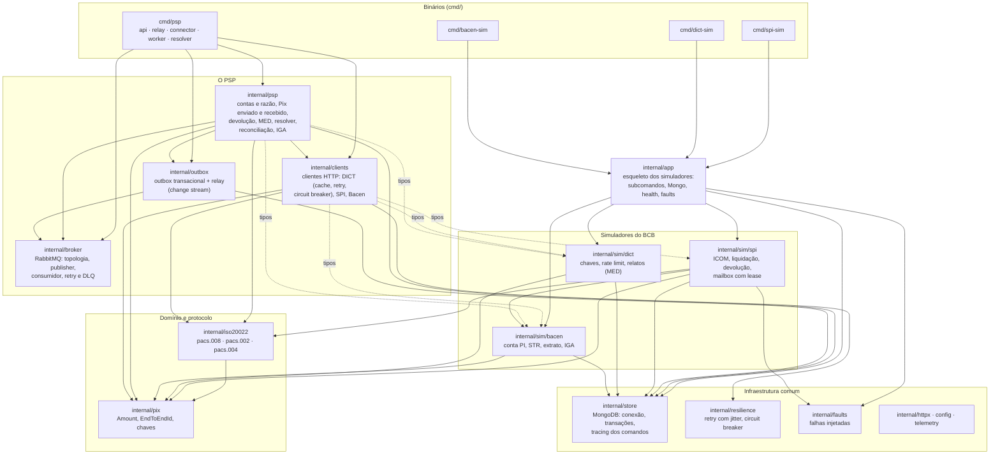
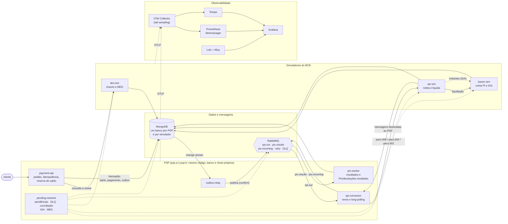

# Módulos do sistema

Dois mapas do mesmo sistema: os **pacotes Go** (quem depende de quem no código) e os
**componentes em execução** (quem fala com quem quando a stack está no ar). Os detalhes
de cada parte estão em [arquitetura.md](arquitetura.md).

## 1. Pacotes Go

Cada seta é um `import`. Ficaram de fora, para não poluir, as dependências que quase todos
têm de `config`, `telemetry` e `httpx`. A regra de leitura: o que está embaixo não conhece o
que está em cima; `clients` e `psp` só importam os **tipos** dos simuladores (os simuladores
nunca importam `clients`, o que evitaria um ciclo).

## 2. Componentes em execução

Os dois PSPs (`psp-a`, ISPB 11111111, e `psp-b`, ISPB 22222222) rodam o mesmo código, cada
um com banco e vhost próprios. As setas contínuas são o caminho de um Pix; as pontilhadas são
processos de apoio (reprocessamento, conciliação, medição, MED).

## Como ler os dois juntos

| Componente | Binário | Pacote principal |
|---|---|---|
| payment-api | `cmd/psp api` | `internal/psp` (serviço e API HTTP) |
| outbox-relay | `cmd/psp relay` | `internal/outbox` |
| spi-connector | `cmd/psp connector` | `internal/psp` (`Connector`) e `internal/broker` |
| pix-worker | `cmd/psp worker` | `internal/psp` (`HandleResult`, `HandleIncoming`) |
| pending-resolver | `cmd/psp resolver` | `internal/psp` (`Resolver`, DLQ, conciliação, IGA, MED) |
| spi-sim | `cmd/spi-sim` | `internal/sim/spi` |
| dict-sim | `cmd/dict-sim` | `internal/sim/dict` |
| bacen-sim | `cmd/bacen-sim` | `internal/sim/bacen` |
